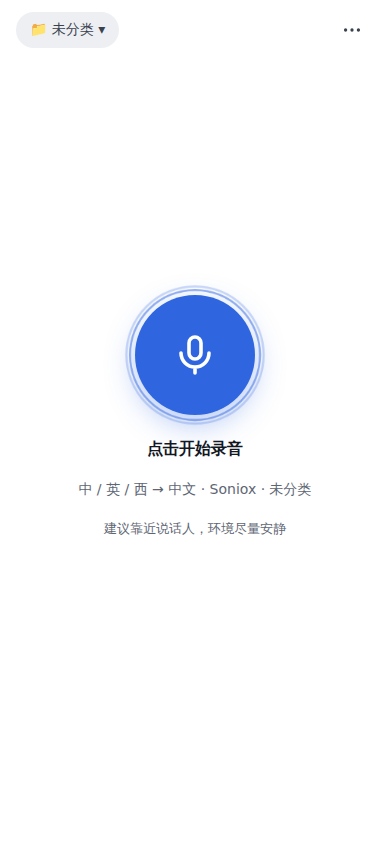
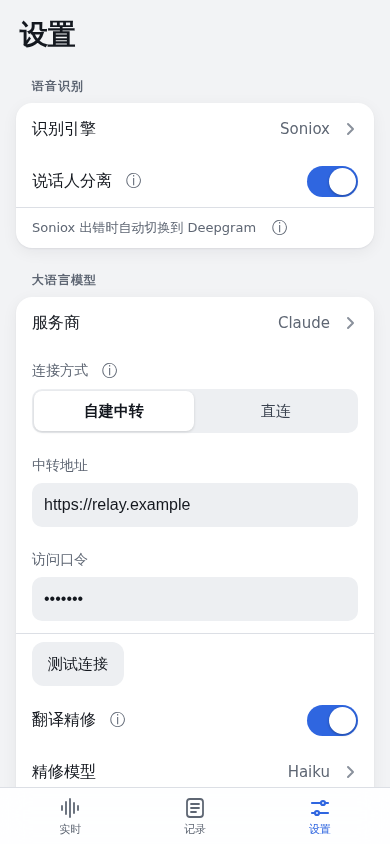

# 同声字幕

手机网页版实时字幕：听中文、英文、西班牙语，实时显示译文（英文、西语 → 中文，中文可选译为英文）。纯 HTML/CSS/JS，单文件 `index.html`，无构建步骤，用 GitHub Pages 部署。

| 未录音 | 录音中 | 设置 |
|---|---|---|
|  |  |  |

## 主要功能

- **实时识别 + 翻译**：默认 Soniox（自动识别中 / 英 / 西，内置实时翻译），出错时自动切换到 Deepgram；也可选浏览器自带识别。
- **翻译精修**：后台用你选的大语言模型（Claude / DeepSeek / OpenAI）结合上下文和术语校对。
- **两种翻译模式**（设置 → 识别与翻译 → 翻译模式）：
  - **单向翻译**（默认）：自动识别中 / 英 / 西，译为中文；中文内容可选不翻译或译为英文。
  - **双语互译**（也可在主页「⋯」菜单里一键开关）：选语言 A、B（默认中文 ⇄ 西班牙语，可点「⇄」交换），A 的话译成 B、B 的话译成 A，需要 Soniox；A、B 以外的语言只显示原文。可开「面对面视图」：录音时字幕区分上下两半，上半部分旋转 180° 给对面的人看（录音中可在「⋯」菜单临时切换）。
- **学习模式**（记录详情 → 顶部「字幕 / 学习」）：对外语句子逐句分析，检查语法错误和不自然的表达，讲解词汇和语法点（按「我的水平」A1～C1 筛选，选中时显示该水平会讲什么；A1 入门几乎逐词讲解），解释用中文。**口语现象（省略、重复、口头禅）和语音识别听错的地方不算语法错误**，只标成灰色的「口语」「可能识别有误」；红色「语法」「表达」才是需要改的。可只分析某个说话人（检查自己说的话），按批请求、可随时停止、结果保存在记录里（不重复收费），支持单句循环跟读。
- **目录**（记录详情，播放器下方）：为每条记录自动生成带时间点的分级大纲（章节 + 小节），和摘要一起生成；点击跳转到该处播放，播放时当前章节高亮；字幕里有章节分隔标题（点击折叠 / 展开），进度条上有章节标记；可长按重命名、删除、升降级，长按字幕「从这里开始新章节」；导出的笔记带目录，可「复制章节列表」（每行「00:00 标题」，和视频平台的章节格式一致）。
- **生词本**：学习模式里点词汇胶囊 →「☆ 收藏」，或在句子卡片上「☆ 收藏句子」（单词和句子分两栏）；入口在设置 → 学习 → 生词本，和记录页「⋯」菜单。按语言分组，显示释义和出处（点一下回到原句并播放），可搜索、删除，「导出 CSV」后可导入 Anki 等背单词软件；随 OneDrive 同步。
- **说话人分离**、**场景与术语**、字号与显示方式、深色模式。
- **记录**：字幕和录音自动保存在手机本地，标签、文件夹、自动摘要、点句跳播、导出（录音 / SRT / Markdown / 备份）。
- **OneDrive 同步**（可选）：录音和全部记录在 iPhone 与电脑之间自动同步。

## 快速开始

1. **部署页面**：仓库 Settings → Pages，选择分支，用 https 网址打开。
2. **部署中转（推荐）**（手机连不上 Soniox 时，Soniox 的实时音频也可以经它转发，见设置 → 识别与翻译 →「Soniox 连接」）：把 `worker/worker.js` 部署到 Cloudflare Workers，添加 Secret `ACCESS_TOKEN` 和要用的服务商密钥（如 `SONIOX_API_KEY`、`ANTHROPIC_API_KEY`）。
3. **在页面里设置**：右上角「⋯」→ 设置 → 连接与密钥 → 连接方式选「自建中转」，填中转地址和访问口令，点「测试连接」。
4. 回到主页，点中间的大按钮开始录音。

不想部署中转时，也可以「直连」：只填 Claude 和 Deepgram 的密钥（这种方式不能用 Soniox 和 OneDrive 同步）。

## 文档

- [功能说明](docs/features.md)：界面、多语言识别、双语互译、引擎切换与自动备用、翻译精修、记录与摘要、设置迁移
- [部署与配置](docs/setup.md)：获取密钥、费用参考、Cloudflare Worker 中转、接口说明、使用注意
- [OneDrive 同步](docs/onedrive.md)：设计与同步规则、首次同步（空应用文件夹）与排查、Azure 应用注册、KV 配置
- [手动测试清单](docs/testing.md)
